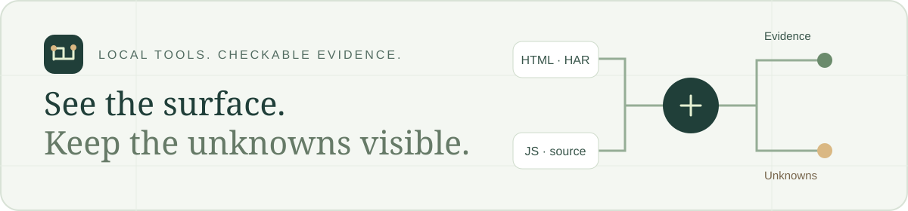
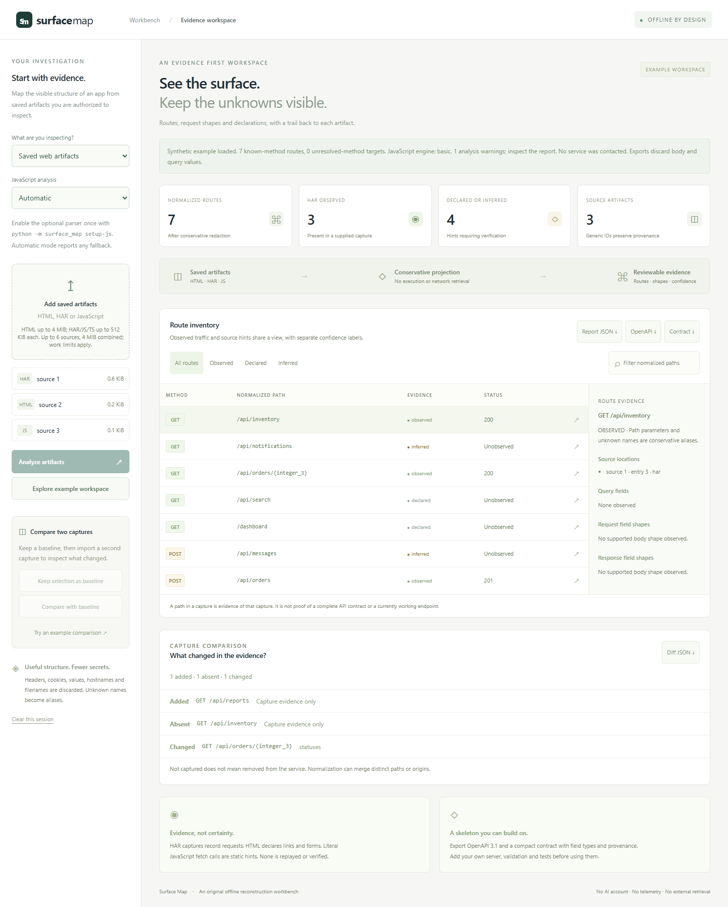

<p align="center">
  
</p>

<h1 align="center">Surface Map</h1>

<p align="center"><strong>Give your agent a map it can check.</strong></p>
<p align="center">Turn website evidence into routes, source references, change reports, and clear unknowns.<br>Free to run. No AI account or API key required.</p>

<p align="center">
  <a href="#run"><strong>Try it locally</strong></a> ·
  <a href="docs/MCP.md">Use with an agent</a> ·
  <a href="docs/CI.md">Check pull requests</a> ·
  <a href="docs/TRY_IT.md">Five-minute trial</a>
</p>

<p align="center">
  <a href="https://github.com/Jgolding1998/surface-map/actions/workflows/test.yml"></a>
  <a href="https://github.com/Jgolding1998/surface-map/actions/workflows/browser.yml"></a>
  <a href="LICENSE"></a>
</p>

A form points to an endpoint. A script hints at a request. A HAR records traffic.
Surface Map keeps those facts separate, shows where they came from, and makes
missing information visible before you hand the work to another developer or agent.

## Run

**Requires Python 3.11 or later.** The bundled basic trial needs no signup,
Node.js, or paid service.

```sh
git clone https://github.com/Jgolding1998/surface-map.git
cd surface-map
python -m surface_map --open
```

Prefer no Git? [Download the source ZIP](https://github.com/Jgolding1998/surface-map/archive/refs/heads/main.zip),
extract it, and open a terminal in the folder containing `surface_map`.
Run the final command above. Replace `python` with `py -3` on Windows or `python3`
on macOS/Linux if that is your Python command.

Choose **Saved web artifacts → Basic lexical hints → Try an example agent brief**.
Review the evidence, choose a simple, developer, or Gen Z introduction, and copy
the brief for your agent. Styles change the wording; facts and uncertainty stay the same.

If the browser does not open, visit **http://127.0.0.1:8768**. Keep the terminal
running; press **Ctrl+C** to stop. For a busy port:

```sh
python -m surface_map --port 9000 --open
```

For stronger JavaScript, JSX, and TypeScript inspection, install **Node.js
24.22.1 or later in the 24.x line**, then explicitly install the pinned parser:

```sh
python -m surface_map setup-js
```

Setup installs locked dependencies with lifecycle scripts disabled. Analysis
does not install packages. Basic mode recognizes fewer patterns; required syntax
analysis reports failures rather than silently switching to weaker parsing.

<details>
<summary><strong>See the workspace</strong></summary>



This screenshot shows the saved-artifact workspace with synthetic data.
The [trial guide](docs/TRY_IT.md) covers current example-brief and public-URL controls.

</details>

## What can I use it for?

| Your task | What you get | Start here |
| --- | --- | --- |
| Hand an unfamiliar web flow to a developer or agent | Routes, source references, a brief, and explicit unknowns | [Local trial](docs/TRY_IT.md) |
| Review a pull request | Supported endpoint, field, script/domain, navigation, and tracking changes | [Automatic Git comparison](docs/CI.md#automatic-static-source-comparison) |
| Inspect a public page | A bounded HTTPS capture and a brief from the same evidence | [Public-page mode](docs/TRY_IT.md#try-a-public-url-without-preparing-files) |
| Inventory selected implementation files | Minimized language, dependency, capability, and literal-import hints | [Source inspection](docs/REFERENCE.md#inspect-selected-source-files) |

## Use from an agent with MCP

Claude, Codex, and other local MCP clients can call the same evidence tools.
The [MCP installation guide](docs/MCP.md) includes setup, schemas, examples, and
limits. The [recorded agent demo](docs/AGENT_DEMO.md) shows what was tested.

Surface Map makes no model API calls. If you give its output to an external
agent, that agent's normal account terms and usage costs apply.

## Check changes in a pull request

The companion GitHub Action reads selected HTML, JavaScript, and TypeScript from
two Git commits. **No screenshots or hand-made capture files are required.**
It does not build or run the proposed app.

It flags supported changes to form destinations and methods, hidden fields and
duplicate controls, resources/domains, page-local navigation, and tracking calls.
Incomplete comparisons are identified explicitly. Private identifiers become
comparison-local opaque IDs in the report.

[Add it to your PR workflow →](docs/CI.md#add-it-to-prs)

## Privacy choices

Saved-artifact analysis runs locally without uploading captures or executing
their source. Reports exclude raw source, filenames, headers, cookies, query
values, and body values. Unknown web paths and field names become aliases; Git
review adds comparison-local IDs. Unknown dependency names are omitted and counted.

**Public HTTPS page mode makes explicit network requests** from your computer.
It uses no browser login or cookies and does not render pages, crawl links, submit
forms, or replay API requests.

Minimization can hide distinctions and still reveal application facts.
Review exports before sharing. See the [security boundaries](SECURITY.md).

## Practical limits

- Source evidence does not prove an endpoint works, a server accepts a request,
  or an analytics event is delivered.
- Dynamic code, framework routing, arbitrary tracking wrappers, and unsupported
  syntax can leave gaps. Reports keep coverage limits visible.
- This does not clone a working app or perform a security audit.
  Optional generated mock handlers return 501 until implemented.
- Saved web selections have a six-artifact cap; project inspection accepts up to
  24 explicitly selected files. This is not a whole-site scanner.

[Full reference](docs/REFERENCE.md) · [PR coverage](docs/CI.md#checks-requested-in-the-pr-feedback) · [Rebuild plans](docs/REBUILD.md)

## Check it

```sh
python -m unittest discover -s tests -v
```

JavaScript checks need the optional pinned parser. CI separately exercises MCP,
browser workflows, the PR Action, privacy controls, and regression collections
on Linux and Windows. Test counts and development fixtures do not establish
accuracy on every website or superiority over another tool.

[Evaluation results and caveats](docs/REFERENCE.md#check-it) ·
[Alternative tools and research](docs/RESEARCH.md)

## Help us find what it misses

Try one flow you own or are authorized to inspect. Tell us what was wrong,
what was missing, and whether it saved you any work. A small synthetic example
is enough; keep private captures and credentials out of public issues.

[Share trial feedback](https://github.com/Jgolding1998/surface-map/issues/new?template=real-world-trial.yml) ·
[Contribute](CONTRIBUTING.md) ·
[Report a vulnerability privately](https://github.com/Jgolding1998/surface-map/security/advisories/new)

Licensed under [MIT](LICENSE).
