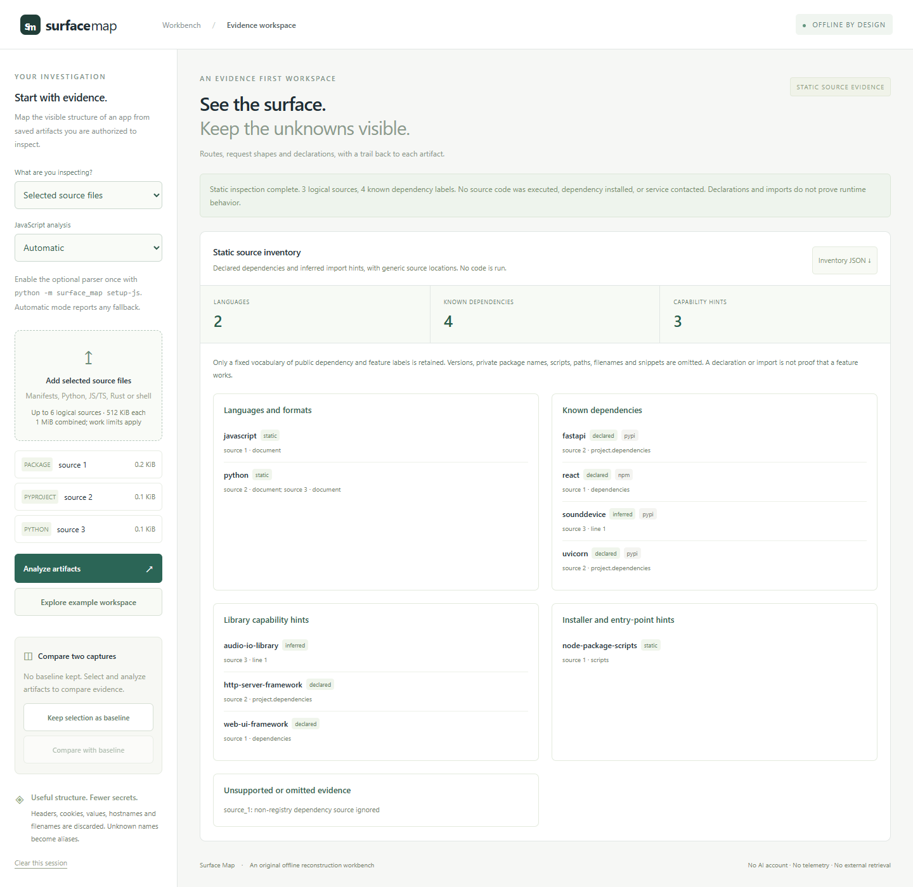

# Surface Map

Inspect saved web artifacts and selected source files without running them. Build a route inventory and API skeleton from web captures, or a minimized language, dependency and library-capability inventory from source. Useful when documenting an app you own or comparing authorized captures.


## Run

Python 3.11 or later. No third-party Python packages or AI account are required.

```sh
python -m surface_map
```

Open **http://127.0.0.1:8768**. A synthetic example loads automatically. Choose `--port 9000` if needed.

## Use

1. Choose **Saved web artifacts** and add UTF-8 HTML, HAR or JavaScript files you own or have permission to inspect.
2. Analyze the selection. Inspect each route's generic source ID and line or HAR-entry location.
3. Export the report, an OpenAPI 3.1 skeleton, or the compact contract as JSON.
4. To compare captures, keep the first analyzed selection as a baseline, import and analyze the second, then compare. Clear the session to release both selections and reports from the page.

| Evidence | What is extracted | Label |
| --- | --- | --- |
| HAR | Request method, normalized path, status, query names and supported JSON body shapes | Observed |
| HTML | Links, form actions and control names, script and stylesheet asset paths | Declared |
| JavaScript | Literal `fetch` URLs, single-binding module string constants and simple literal methods | Inferred |

No source is executed, no traffic is replayed, and no URL is fetched. Inline scripts inside HTML are ignored. Import a separate JavaScript file to inspect its literal fetch hints.

## Inspect selected source files

Choose **Selected source files** in the workspace. Add saved `requirements.txt`, `pyproject.toml`, `package.json`, `Cargo.toml`, or supported Python, JavaScript/TypeScript, Rust and POSIX shell files. Analyze, inspect each generic source location, and export **Inventory JSON**. A synthetic source example is available in this mode. Keep a source selection as a baseline to compare added, absent, and changed static evidence in another selection.

The source view separates manifest declarations from inferred import hints. It recognizes a curated vocabulary of public libraries and their usual roles, such as HTTP frameworks, audio I/O or desktop frameworks. A dependency declaration, import, or installer hint does not prove that the application uses that library at runtime or implements its associated feature. Unknown dependency names are omitted and counted. Versions, project names, maintainers, source paths, command text and snippets are never exported.



The CLI prints the same minimized inventory without starting a server:

```sh
python -m surface_map inspect --files requirements.txt example.py
python -m surface_map inspect --files package.json Cargo.toml > inventory.json
python -m surface_map inspect --capture selection.source.json > inventory.json
```

The selected-file CLI reads only the explicit ordinary files supplied. It does not walk a checkout, follow symbolic links or Windows reparse points, access Windows UNC/device paths, mapped network drives or alternate streams, open requirements includes, install dependencies, fetch GitHub URLs, or run an installer. Save the authorized files first. A source capture JSON can supply logical files without retaining their original names:

```json
{"artifacts":[{"kind":"requirements","content":"fastapi\nuvicorn\n"},{"kind":"python","content":"import sounddevice\n"}]}
```

Capture kinds correspond to the supported formats: `requirements`, `pyproject`, `package`, `cargo`, `python`, `javascript`, `typescript`, `rust`, and `shell`. The browser accepts individual manifests and source files; capture JSON is a CLI input. Keep a private mapping from source IDs to your selected files if you need to trace an exported line back to the original.

Each source reports `parsed` or `rejected`. Unsupported syntax or structural limits can reject one file while other files still contribute evidence; inspect warnings before using the report. Source comparisons require fully parsed selections, so a parser failure cannot masquerade as a removed dependency. Malformed envelopes, unreadable files and byte-limit failures are controlled errors; CLI failure exits with status 2. No source text or path is included in these errors.

## Privacy choices

Input stays in request memory; the server keeps no uploads or reports. The browser keeps selected File objects while the workspace is open. Exports contain generic source IDs, never original filenames or source snippets.

Headers, cookies, hostnames, query values and body values are discarded. A small fixed vocabulary preserves common route and field names. Other names become aliases, and numeric path segments become inferred parameters. For example, a customer-specific path can become `/api/customers/{integer_3}/{segment_4}`. JSON bodies contribute types and field shapes, without examples, constants or inferred required fields.

This is deliberately lossy. Different origins or private route names can normalize to the same path. Aliases are not the original API's parameter names. Check a report before sharing it; minimization does not establish that every possible sensitive fact is absent.

## Practical limits

- Up to 6 artifacts per capture, 512 KiB each and 1 MiB combined; HAR supports up to 300 entries and 20,000 JSON nodes. Header-heavy captures can reach the node limit before the entry limit.
- Byte caps are not acceptance guarantees. JSON nesting, collections, routes and HTML tags are bounded. JavaScript supports up to 300,000 lexical tokens with a cooperative three-second tokenizer budget; unusually dense or complex files can be rejected below 512 KiB.
- Source manifests have structural limits, source code has parser and work limits, and evidence lists are bounded. The source inventory uses a cooperative five-second work budget. Registry dependencies are recognized only from a curated list; local paths, URLs, editable installs and Cargo workspace inheritance are not resolved. Shell hints are POSIX only. Simple here-documents are skipped with exact delimiter handling; unsupported or unterminated here-documents and unsupported shell quoting reject that source. Ambiguous parameter, command or ANSI-C expansions on a line containing `<<` also reject the source. Compound guards, command substitution and wrapper options can hide installer commands from the lexical hints. The scanner does not build a call graph, resolve every module or distinguish reachable code from dead code.
- Export serialization stops at 3 MiB, including amplification from combined response shapes. Smaller captures may be needed. Errors include only predefined reasons and generic source IDs, without source text.
- Base64 HAR bodies, non-JSON bodies, dynamic JavaScript calls, archives, APKs, native binaries and .NET assemblies are unsupported. JavaScript hints require unescaped string URLs, or a module-level `const` bound to one such string and used in a direct module-level `fetch` call. Constants are not resolved inside functions, blocks, parentheses or object literals. Constant resolution is disabled by uncertain lexical regions, escaped identifiers, arrow functions, decorators, TypeScript access modifiers, `with` or direct `eval`; another recognized declaration, parameter, import or assignment of the name also disables it. Computed, shorthand, inherited or accessor method definitions are omitted.
- The JavaScript detector finds lexical hints, not complete program behavior. Literal methods are retained when unrelated fetch options use member expressions such as `JSON.stringify(body)`; spreads that could replace the method remain unsupported. Ambiguous regex lines and child-text lines of closed JSX elements are omitted with warnings; JSX is not fully parsed, so text in an element that never closes can still produce hints. A recognized local binding or assignment of `fetch` omits fetch hints, and a recognized rebinding of `require` omits those source import hints. Scope is not analyzed, so one such site disables these hints for the whole file. Uncertain syntax can conceal other bindings. It may miss calls or find calls in code that never runs.
- A HAR observation describes that capture. It does not prove a route still works, is safe to call, or represents a complete service contract.
- OpenAPI exports omit servers. Equivalent redacted path templates merge with combined evidence; a parameter observed as both numeric and text uses a string schema. Body shapes are combined observations, form encoding is unverified, and redaction placeholders are inferred. Supply your own server and validate the contract before using it.
- The saved page URL is unknown, so relative links, form actions, asset paths and fetch URLs are omitted, as are forms without an action. Absolute and root-relative URLs are kept; in-page `#` links are ignored.
- Form methods follow browser submission: `post` is POST, `dialog` is ignored and anything else is GET. GET form controls become query fields. Duplicate HTML attributes use their first value, matching browser handling.
- On Python parsers that change ambiguous attribute references, link and form URLs such as `?page=1&currency=USD` produce a controlled error. Update Python or write `&amp;` in HTML attributes. The guard checks used URL attributes; an unfamiliar attribute tokenizer conservatively rejects ambiguous tags. Asset queries are discarded.
- Comparison reports added, absent and changed normalized evidence. Absence from a capture does not prove removal from a service.

## Check it

```sh
python -m unittest discover -s tests -v
```

The tests cover extraction, browser form and relative URL semantics, evidence labels, body shapes, capture differences, planted-secret redaction across every export, malformed Unicode and JSON, 128/256/500 KiB JavaScript samples, work limits, hostile origins, CSRF, framing, slow header drips, export amplification and processing admission. Source tests add manifest and import inspection, ignored installer arguments and includes, no execution or network, bounded malformed inputs, explicit file selection, minimized CLI errors, and source evidence comparison.

The optional real-browser check uses Node.js and Playwright:

```sh
npm install --no-save playwright
npx playwright install chromium
# Keep the app running in another terminal:
node tests/browser_smoke.cjs
node tests/source_browser.cjs
```

Set `SURFACE_BROWSER_CHANNEL=chrome` to use an installed Chrome. The browser check verifies imports, downloads, filters, capture comparison, clearing, redaction in the page and exported files, and desktop/mobile overflow. It fails on script errors or external requests and refreshes the synthetic screenshots in `docs/`.

The local server binds IPv4 loopback, rejects unexpected hosts and origins, requires a request token, limits concurrent work and uses fixed static routes. See [SECURITY.md](SECURITY.md) for boundaries.
